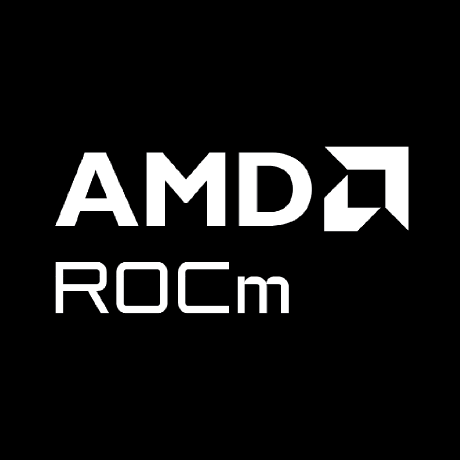

<div align="center">
  
  <h3 align="center">
    AI frameworks, inference, and training on AMD GPUs
  </h3>
  <p align="center">
    <a href="https://rocm.docs.amd.com/en/latest/">
      <b>ROCm Core SDK</b>
    </a>
    <span> • </span>
    <a href="https://rocm.docs.amd.com/projects/ai-ecosystem/en/latest/">
      <b>AI Ecosystem</b>
    </a>
    <span> • </span>
    <a href="https://instinct.docs.amd.com/latest/">
      <b>GPU Systems and Infrastructure</b>
    </a>
    <span> • </span>
    <a href="https://www.amd.com/en/products/software/rocm/rocm-ai.html#inside">
      <b>ROCm.ai</b>
    </a>
    <span> • </span>
    <a href="https://rocm.blogs.amd.com/">
      <b>Blogs</b>
    </a>
  </p>
</div>

# AMD ROCm™ AI Ecosystem

[](LICENSE)
[](https://rocm.docs.amd.com/projects/ai-ecosystem/en/latest/)
[](https://scorecard.dev/viewer/?uri=github.com/AMD-Ecosystem/ai-ecosystem)

This repository contains the documentation source for the ROCm AI ecosystem:
guides covering framework installation and setup, large-scale model training,
LLM and diffusion inference serving, and AI workload performance optimization
on AMD GPUs. The ROCm AI ecosystem lives on top of the [ROCm Core
SDK](https://rocm.docs.amd.com/en/latest/), which provides the underlying GPU
runtimes (HIP), compilers, and math libraries for ROCm-accelerated workloads.

>[!IMPORTANT]
>To learn about supported AMD GPUs and operating systems, see the latest [ROCm
>Core SDK release notes](https://rocm.docs.amd.com/en/latest/about/release-notes.html)
>or the [compatibility matrix](https://rocm.docs.amd.com/en/latest/compatibility/compatibility-matrix.html).

## Build the documentation

The docs are built with [Sphinx](https://www.sphinx-doc.org/).
To build the docs locally, clone this repository, change into the cloned
directory, and complete the following steps.

1. Create and activate a virtual environment.

   <table>
   <tr>
   <th>Linux and WSL</th>
   <th>Windows</th>
   </tr>
   <tr>
   <td>

   ```bash
   python3 -m venv .venv
   source .venv/bin/activate
   ```

   </td>
   <td>

   ```powershell
   py -m venv .venv
   .venv\Scripts\Activate.ps1
   ```

   </td>
   </tr>
   </table>

2. Install Python requirements needed to build the documentation.

   ```shell
   python -m pip install -r docs/sphinx/requirements.txt
   ```

3. Build the docs.

   ```shell
   python -m sphinx -j auto -E docs/ _build/
   ```

   Open `_build/index.html` in a web browser to view the result.

For further information, see [building documentation](https://rocm.docs.amd.com/en/latest/contribute/building.html).

## Contributing

See [CONTRIBUTING.md](CONTRIBUTING.md) for contribution guidelines and the
[ROCm contribution guide](https://rocm.docs.amd.com/en/latest/contribute/contributing.html)
for the broader process.

## Security

See [SECURITY.md](SECURITY.md) for the security policy and how to report a vulnerability.

## License

See [LICENSE](LICENSE).
